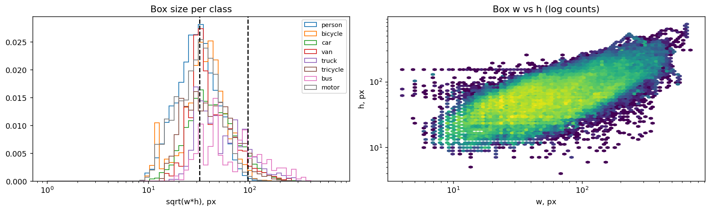
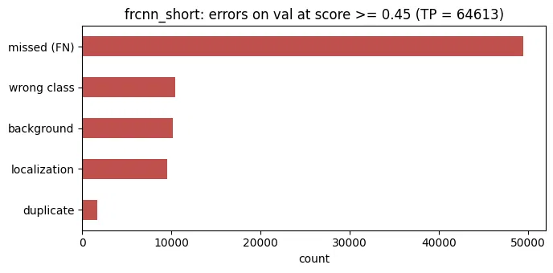
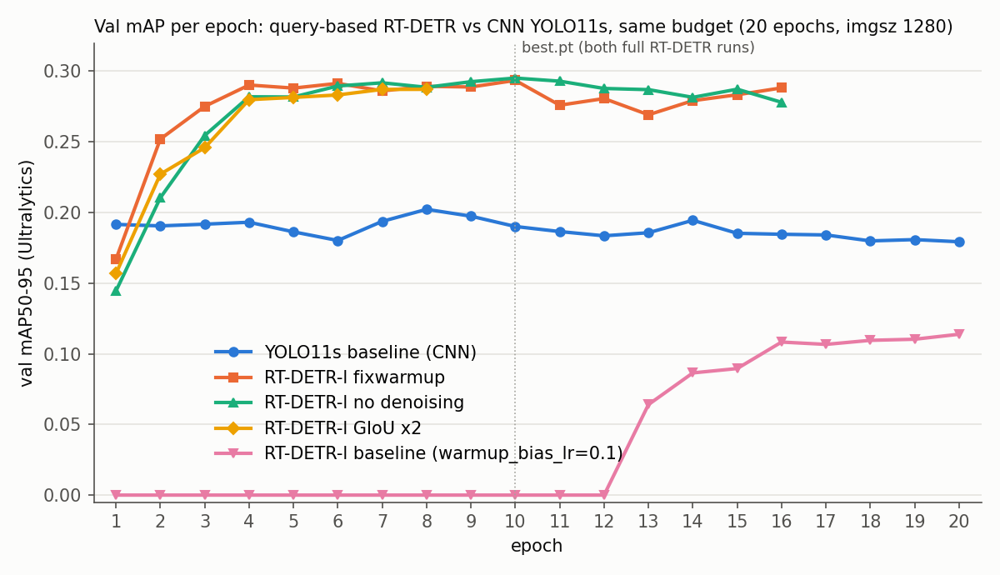

## Introduction

We were given the VisDrone2019-VID: 8 classes with restriction of less than 500 detections per frame. 
There were three main issues with the dataset: tiny objects, dense pictures (nearly 180 objects per frame) and the difference in pictures was mainly in angles, altitude and density etc. Our solution was based on Weighted Boxes Fusion of RT-DETR-l, Faster R-CNN and YOLO11s-P2 followed by temporal rescoring: **public 0.3200, private 0.2515** (baseline 0.22163). To choose the best model we compare them by their mAP.

## Data and preprocessing

| Observation | Decision |
|---|---|
| 53.6% of boxes < 32 px at long side 1280, 9.7% < 16 px | input 1280; P2 head; anchors from data |
| up to ~180 objects per frame, density varies by clip | 500 detections per frame (default 100) |
| car 45.7%, bus 0.9% (3 buses in val) | treat rare-class AP as noisy |
| 97.4% of tracks alive 5 frames later | train on every 5th frame (4 821 frames) |

## Validation protocol
One protocol applied to every model: training each fifth image and validate on all 2846 frames of 7 clips, long side 1280, seed 42, COCO-pretrained weights, best epoch chosen on a quick val (every 10th val frame)

### Models and tuning strategy
 
| Family | Model (library, notebook) | Training |
|---|---|---|
| two-stage, anchors | Faster R-CNN R50-FPN v2 (torchvision, `02`) | SGD lr 0.005, batch 4, warmup 500 it |
| one-stage, anchors | RetinaNet R50-FPN v2 (torchvision, `04`) | SGD lr 0.0025 |
| anchor-free | YOLO11s (Ultralytics, `03`, `03b`) | 20 epochs, patience 6, batch 8 |
| query-based | RT-DETR-l (Ultralytics, `05`) | AdamW lr 1e-4, 20 epochs, patience 6 |

We do only one change per experiment on the best result, so that we can understand the impact of every step. Using NMS to avoid duplicates in detection (intersection > 0.6 -> leaving the only one with the highest confidence)

## Results and analysis

 
### Faster R-CNN (`02_faster_rcnn.py`, `02b_faster_rcnn_failures.py`)
 
| RUN | Change | mAP | AP_small | Public |
|---|---|---|---|---|
| frcnn_baseline | 20 epochs | 0.1924 | 0.0733 | 0.1926 |
| **frcnn_short** | 8 epochs, best epoch | **0.2273** | 0.0984 | 0.2116 |
| frcnn_anchors | anchors 16–256 | 0.2177 | 0.0962 | 0.1992 |
| frcnn_giou | GIoU box loss | 0.2234 | - | - |
| frcnn_mask | gray ignored regions | 0.2158 | 0.0943 | - |

First step algorithm gives 1000 class-agnostic boxes. Then we classify every box in 8 + 1 (bg) categories. 

### RetinaNet (`04_retinanet.py`)
 
| RUN | Change | mAP | AP_small | FPS | Public |
|---|---|---|---|---|---|
| retina_baseline | anchors 32–512, γ = 2 | 0.1723 | | | |
| retina_anchors | k-means anchors 16–256 | 0.1598 | | | |
| **retina_focal** | γ 2 → 1.5 | **0.1751** | 0.0594 | 6.2 | 0.1756 |
 
 
Focal loss down-weights easy background anchors, resolving issue with domination of bg over the loss. Versus Faster R-CNN: 1.5× faster, −0.05 mAP, AP_small 0.059 vs 0.098.

### YOLO11 (`03_yolo_baseline.py`, `03b_yolo_p2.py`)
 
| RUN | Change | mAP | AP_small | AP_medium | AP_large | FPS | Public |
|---|---|---|---|---|---|---|---|
| yolo11s_baseline | defaults | 0.1916 | | | | | 0.1733 |
| **yolo11s_p2** | + P2/4 head | **0.2046** | **0.1138** | 0.1995 | 0.3401 | 20 | 0.2122 |
| yolo11m_p2 | backbone s → m | 0.2079 | 0.1009 | 0.1869 | 0.3459 | 9.7 | |

The Task-Aligned Assigner ranks grid points inside a GT box by score × IoU

### RT-DETR (`05_rtdetr.py`, `05b_rtdetr_eval_checkpoint.py`)
 
| EXP | Change | mAP | AP_small | AP_large | Public |
|---|---|---|---|---|---|
| baseline | defaults | 0.1127 | 0.0422 | | |
| **fixwarmup** | `warmup_bias_lr` 0.1 → 0 | **0.2934** | **0.1385** | 0.4904 | 0.2968 |
| fixwarmup_nodn | no denoising (loss) | 0.2969 | 0.1107 | 0.4975 | 0.3033 |
| giou4 | GIoU weight 2 → 4 (loss) | 0.2928 | 0.1245 | 0.5030 | |
 

The default run scored 0 for 12 epochs because `warmup_bias_lr=0.1` (meant for YOLO + SGD) made the bias LR ~2000× the weight LR under AdamW; setting it to 0 gave the best single model, while both loss changes (no denoising, GIoU ×2, the latter stopped at 8/20 epochs) only traded small-object AP for large.

### Data and inference experiments (`06_sahi_tta.py`, yolo11s_p2 weights)
 
| Change | val mAP | Public |
|---|---|---|
| reference: NMS 0.6, 1280 | 0.2046 | 0.2122 |
| NMS 0.7 / TTA | 0.2044 / 0.2048 | |
| inference 1600 / 1920 | 0.2063 / 0.1956 | |
| SAHI 2×2 + full frame | **0.2104** | 0.2027 |
| SAHI on yolo11s_baseline | 0.2032 (vs 0.1916) | 0.1673 (vs 0.1733) |
 
SAHI won on val and lost on public twice (and private for P2), also on val frames downscaled to test sizes; we trusted the leaderboard and dropped it.

### Ensemble (`07_wbf.py`)
 
| tag | Models (weights), IoU 0.7 | mAP | AP_small | Public | Private |
|---|---|---|---|---|---|
| — | frcnn + retina (2:1) | 0.2390 | 0.1044 | 0.2242 | 0.2087 |
| frcnn_retina_p2x2 | frcnn + retina + p2 (1:1:2) | 0.2515 | 0.1272 | 0.2503 | 0.2246 |
| detr_frcnn_p2_eq | rtdetr + frcnn + p2 (1:1:1) | 0.2991 | 0.1407 | | |
| **detr2_frcnn_p2** | rtdetr + frcnn + p2 (2:1:1) | **0.3095** | **0.1461** | 0.3155 | 0.2485 |
 
Searched on quick val: IoU 0.7 > 0.6 > 0.5; double weight on the strongest model helps, on a weaker one hurts; RetinaNet lowers every RT-DETR combination. The ensemble has the best AP_small of all models.

### Temporal rescoring (`08_temporal.py`)
 
| Step (every 5th val frame) | mAP |
|---|---|
| WBF, no temporal | 0.3112 |
| rescoring (k = 3, α = 0.2) | 0.3138 |
| + camera-motion compensation | 0.3143 |
| + filling missed frames | no change |
 
Full val 0.3095 → 0.3128, public +0.0045, private +0.003. Rescoring gives almost the whole gain; motion compensation is within noise; filling did nothing, because with scores down to 0.001 a "missed" object already has a weak box.

### Summary
 
| Model | mAP | AP50 | AP_small | FPS | Public | Private |
|---|---|---|---|---|---|---|
| Faster R-CNN | 0.2273 | 0.4621 | 0.0984 | ~4 | 0.2116 | 0.1996 |
| RetinaNet | 0.1751 | 0.3320 | 0.0594 | 6.2 | 0.1756 | 0.1608 |
| YOLO11s-P2 | 0.2046 | 0.4157 | 0.1138 | 20 | 0.2122 | 0.1784 |
| RT-DETR-l | 0.2934 | 0.5479 | 0.1385 | 4.9 | 0.2968 | 0.2267 |
| WBF | 0.3095 | 0.5756 | 0.1461 | | 0.3155 | 0.2485 |
| **WBF + temporal** | **0.3128** | **0.5803** | **0.1493** | | **0.3200** | **0.2515** |
 

 
Helped: warmup fix, RT-DETR, P2, best-epoch selection, weighted WBF, temporal. Did not: smaller anchors, masking, GIoU (Faster R-CNN), SAHI, larger YOLO backbone, RT-DETR loss changes for small objects.

## Final model and run instructions
 
Selected: **WBF `detr2_frcnn_p2` + temporal** (private 0.2515, counted) and **WBF `detr2_frcnn_p2`** (0.2485) as a fallback.
 
| # | Notebook | Setting | Device | Input |
|---|---|---|---|---|
| 1 | 02_faster_rcnn | `RUN='frcnn_short'` | GPU T4 | competition data |
| 2 | 03b_yolo_p2 | `SCALE='s'`, `LOSS='ciou'` | GPU T4 | data |
| 3 | 06_sahi_tta | `TAG='yolo11s_p2'`, `SUBMIT='nms_0.6'` | GPU T4 | data + `best.pt` from 2 |
| 4 | 05_rtdetr | `EXP='fixwarmup'` | GPU T4 | data |
| 5 | 07_wbf | as in file, `TOP_K=500` | CPU | data + outputs of 1, 3, 4 |
| 6 | 08_temporal | `SRC='detr2_frcnn_p2'` | CPU | data + output of 5 → `submission.csv` |

On Kaggle: `common.py` as the first cell, `DEBUG = False`, Internet on, seed 42 (`seed_everything`), every 5th train frame, input 1280. Dependencies installed in the notebooks: `ultralytics`, `pycocotools`, `ensemble-boxes`, torchvision from the Kaggle image. T4 training time: Faster R-CNN ≈ 2 h, YOLO11s-P2 ≈ 2.7 h, RT-DETR ≈ 4.4 h. Other notebooks (`01`, `02b`, `03`, `04`, `05b`, `09`) reproduce the analyses and the remaining runs from Results.
